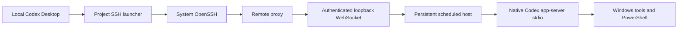

# Codex Windows SSH Adapter

[English](README.md) | [简体中文](docs/README.zh-CN.md)

Connect Codex Desktop's **Settings → Connections → SSH** to a native Windows Codex CLI. Use one local launcher for your Windows SSH hosts, keep remote processes running across SSH disconnects, and forward Desktop MCP tools through the existing SSH tunnel.

**Experimental, unofficial compatibility adapter.** Tested against Desktop `26.1013.4894.0` and CLI `0.162.0`. Desktop protocol changes may require adapter changes; the launcher checks the installed App version before starting it.

## Features

- Detects Windows automatically for recognized Codex SSH startup commands. New hosts do not need an adapter-specific allowlist.
- Uses existing SSH aliases, keys, ports, `Include`, `ProxyJump`, and `ProxyCommand` settings.
- Deploys a private runtime and a per-user scheduled task on first connection; reuses compatible existing installations.
- Keeps native Codex and its terminal child processes alive when SSH disconnects. The same client identity reattaches to its existing session.
- Preserves native Windows execution and the remote CLI's existing PowerShell configuration.
- Adapts Desktop's MCP reverse-forward listener check to Windows while preserving loopback binding and authentication.
- Passes ordinary SSH commands and detected Unix hosts to system OpenSSH.

The adapter uses a process-local `PATH` override. It does not patch Desktop, replace system SSH, change the system `PATH`, or change the remote SSH default shell. The remote Codex Desktop App does not need to be running.

## Requirements

| Local Windows computer | Remote Windows computer |
| --- | --- |
| Windows x64 and the tested Codex Desktop version | Windows 10/11 x64 with working OpenSSH Server and SFTP |
| Node.js 22+ x64 and npm | Native Codex CLI supporting `app-server --stdio` |
| Windows OpenSSH client (`ssh.exe`, `scp.exe`) | CLI account/configuration ready for the intended work |
| Windows PowerShell 5.1 and .NET Framework C# compiler | Windows PowerShell 5.1 and Task Scheduler |
| Noninteractive SSH access using a key or SSH agent | Permission to register a scheduled task for the SSH user |

Remote Node.js is bundled during setup. PowerShell 7 is optional for adapter operation, but live integration tests require `pwsh.exe`. ARM64 has not been validated. S4U tasks are preferred; an Interactive task fallback requires the Windows user to stay signed in.

## Quick start

1. Clone into a directory of your choice and open PowerShell there:

   ```powershell
   git clone https://github.com/OliverGrace/codex-windows-ssh-adapter.git
   cd codex-windows-ssh-adapter
   npm ci --ignore-scripts
   npm run build
   npm run prepare:remote
   ```

   The build creates the local launcher and `adapter.config.json` from the example. Packaging compiles the remote launchers and copies your Node runtime and its matching license. Generated files stay local.

2. Add a host to `%USERPROFILE%\.ssh\config` if needed. Replace these example values:

   ```sshconfig
   Host windows-dev
       HostName windows-host.example.com
       User your-windows-user
       IdentityFile ~/.ssh/id_ed25519
       IdentitiesOnly yes
   ```

   Connect once with system SSH to verify the host key and authentication, then verify noninteractive access:

   ```powershell
   & "$env:WINDIR\System32\OpenSSH\ssh.exe" windows-dev hostname
   & "$env:WINDIR\System32\OpenSSH\ssh.exe" -o BatchMode=yes windows-dev hostname
   ```

3. Fully exit the running local Codex App using its menu or tray. Double-click **`Launch-Codex-Windows.cmd`**, then select the host in **Settings → Connections → SSH**.

4. Open a remote Windows project directory and start working. Subsequent Windows hosts use the same launcher and SSH settings; no adapter alias registration is required.

First connection uploads roughly 34 MiB with the tested Node runtime, verifies SHA-256 remotely, and creates the background task. For a slow connection, prepare the host before connecting in the App:

```powershell
node scripts/setup-host.mjs --check windows-dev
npm run install:remote -- windows-dev
node scripts/remote.mjs status windows-dev
```

`--check` probes without installing. Setup reuses compatible `0.2.0` or `0.3.0` services without replacing files, tokens, or running processes. It is not an in-place upgrade command.

## Configuration

`adapter.config.json` is local and ignored by Git. Commit only `adapter.config.example.json`.

| Setting | Meaning |
| --- | --- |
| `autoDetectWindows` | Detect Windows for recognized Desktop SSH commands; enabled by default. |
| `aliases` | Legacy allowlist when automatic detection is disabled; leave empty for general use. |
| `realSsh` | Absolute path to system `ssh.exe`; adjust the standard Windows path in the example if needed. |
| `durableHost` | Enables the persistent host in legacy mode; automatic mode uses it for Windows. |
| `remoteCodexCommand` | Legacy command name; automatic discovery finds the native CLI. |
| `maxMessageBytes` | Local bridge message limit, default 16 MiB. |
| `testedAppVersion` | Desktop version gate. Run compatibility checks before changing it. |

The launcher sets `CODEX_WINDOWS_SSH_AUTO=1` for its App process. CLI discovery covers common npm installations, executable paths, `.local\bin`, and WinGet links. For a custom installation, set **remote** `CODEX_CLI_PATH` to the real `codex.exe`, visible to the SSH login environment.

## Architecture



The scheduled host owns Codex's stdio; SSH only attaches and detaches a proxy. The host coordinates initialization, request IDs, approvals, and buffered notifications. A connection with the same client identity takes over that identity's session. Up to 12 identities are retained, with a 32 MiB offline notification buffer per session.

The remote task is named `CodexWindowsSshAdapter`. Files live in `%LOCALAPPDATA%\CodexWindowsSshAdapter`, restricted to the Windows user and SYSTEM. A random token authenticates a dynamically allocated loopback WebSocket; the token stays remote. No LAN listener or firewall exception is created.

The native launcher uses a Windows Job Object to own the host and its children. **Stopping the scheduled task terminates its Codex sessions, terminals, and child processes.** Disconnecting SSH does not stop that task.

## MCP and disconnect limits

Desktop's `-R 127.0.0.1:port:127.0.0.1:port` tunnel and Bearer authentication are preserved. A Windows `Get-NetTCPConnection` check accepts exactly one IPv4 loopback listener at the expected port. The SSH server must permit reverse TCP forwarding; the adapter does not change `sshd_config`.

The host adds `localhost`, `127.0.0.1`, and `::1` to its Codex children's `NO_PROXY`/`no_proxy` while retaining existing proxy settings.

- Local MCP tools are unavailable while the tunnel or local App is down. In-flight calls may fail; failed tool calls are not repeated automatically.
- If restarting Desktop changes the MCP endpoint or token, reopen/resume the thread to obtain its new Desktop MCP configuration.
- Remote reboot, shutdown, sleep, crashes, or manually stopping the task can interrupt work. Process memory cannot be restored after a process ends.
- Pending approvals remain pending; reconnecting never approves them automatically.
- Buffer overflow drops the oldest notifications. `status.json` reports `droppedNotifications`. Persist important command logs to files.
- Terminal continuity is supported at the protocol level. Restoring terminal tabs after a full App restart depends on Desktop's UI.
- S4U sessions do not automatically receive interactive network-share credentials. Verify UNC paths and network drives separately.
- Desktop's remote CLI installation/upgrade and kill-all management commands are not implemented. Maintain the native CLI directly after active work finishes.

## Operations and troubleshooting

```powershell
npm run doctor
node scripts/remote.mjs status windows-dev
node scripts/remote.mjs start windows-dev
```

Only stop the remote host after its tasks finish:

```powershell
node scripts/remote.mjs stop windows-dev
node scripts/remote.mjs start windows-dev
```

| Symptom | What to check |
| --- | --- |
| Launcher says Desktop is running | Fully exit it, then use this project's launcher. |
| Version gate rejects Desktop | Review new App compatibility before changing the version setting. |
| Host absent from SSH settings | Add a valid SSH config alias and verify system SSH access. |
| Authentication or host-key failure | Fix the underlying SSH connection; checks are not bypassed. |
| CLI not found | Run Codex under the SSH user or set remote `CODEX_CLI_PATH`. |
| First connection times out | Run `npm run install:remote -- windows-dev`, then reconnect. |
| Task registration fails | Check Task Scheduler permissions; Interactive fallback needs a signed-in user. |
| MCP unavailable | Check SSH reverse forwarding policy; fully restart the local App if it cached an earlier failure. |
| Agent shell differs from terminal tab | The agent uses CLI shell settings; an App terminal may start Windows PowerShell. Run `pwsh` there if desired. |

Local `logs/adapter.jsonl` records operation metadata, not prompts or credential values. Ignored `work/` contains caches, fixtures, and reports that may include machine names and paths. Review and redact diagnostic output before sharing.

To stop loading the local adapter, exit the App and launch its normal shortcut. The remote task remains running. To uninstall remotely, finish active work, stop the adapter, remove its scheduled task, and remove only `%LOCALAPPDATA%\CodexWindowsSshAdapter`. Keep the original `.codex` directory.

## Development and validation

`main` is the default publication branch; `dev` stays local and is not pushed to GitHub. Both exclude personal configuration and generated state. See [Contributing](CONTRIBUTING.md) for checks, opt-in live tests, and branch workflow.

```powershell
npm test
git add .
npm run check:publication
```

The default suite runs 12 local tests without Desktop, SSH credentials, or a model account. CI also compiles Windows launchers. Publication checks inspect the Git index for prohibited files and common sensitive patterns; review the staged diff as well.

Prior live validation covered one native Windows host, an unlisted SSH route to that same host, a fresh isolated `0.3.0` installation, PowerShell execution, forced disconnect/reconnect, and authenticated MCP before and after reconnection. A real ephemeral agent completed a command during an SSH outage. These are historical results, not tests repeated by every CI run. A second physical host, ARM64, and a standard non-admin account have not been validated. Unix routing has local coverage, not a completed live Linux acceptance test.

## Repository layout

| Path | Purpose |
| --- | --- |
| `src/` | SSH translation, bridge, host discovery, native launcher source |
| `remote/` | Installer, persistent host, proxy, and task entry points |
| `scripts/` | Build, launch, setup, diagnostics, publication checks |
| `tests/` | Local and opt-in live integration tests |
| `docs/` | Chinese user and contributor documentation |
| `third_party/` | Component notices; downloaded license cache is ignored |
| `bin/`, `work/`, `logs/` | Generated or machine-specific files; never committed |

See [third-party notices](third_party/README.md) for dependency and licensing details. This is not an official OpenAI product. Background references: [Codex remote connections](https://learn.chatgpt.com/docs/remote-connections) and [app-server](https://learn.chatgpt.com/docs/app-server).
